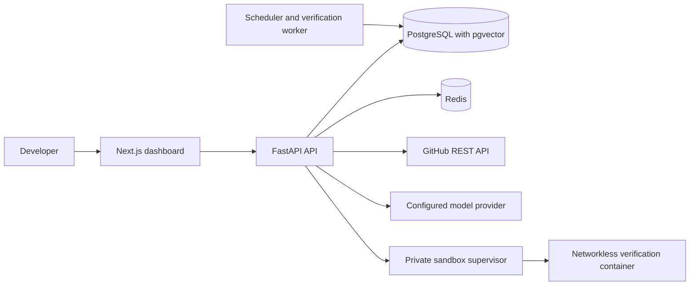

<div align="center">
  <p></p>
  <p><strong>Your self-hosted AI engineering team</strong></p>
  <p>Give a teammate repository work, review its changes and verification evidence, then decide whether to open a draft pull request.</p>
  <p>
    <a href="#what-solvyn-does">Features</a> ·
    <a href="#architecture">Architecture</a> ·
    <a href="#quick-start">Quick start</a> ·
    <a href="API.md">API</a> ·
    <a href="#documentation">Docs</a>
  </p>

  <p>
    <a href="https://github.com/mahirmlk/Solvyn/actions/workflows/ci-cd.yml"></a>
    
    
    
    
    
    
  </p>
</div>

Solvyn is a self-hosted workspace for teams that want AI assistance with ongoing engineering work. Connect a GitHub repository, assign a task to a configured teammate, and review the resulting workspace diff and verification evidence. With approval, an owner or admin can ask Solvyn to open a draft pull request. A person reviews and merges it; production deployment remains an operator-controlled step.

> Solvyn is under active development. The task, repository, approval, workspace, verification, and draft-delivery components are present. The full product workflow and production deployment still need release validation. See the [shipment readiness assessment](docs/SHIPMENT_READINESS.md).

## What Solvyn does

- Connects public GitHub repositories or private repositories authorized through an encrypted organization integration.
- Inspects bounded repository trees and manifests, then lets an authorized user seed a task workspace with selected files from one pinned commit.
- Gives each teammate file tools according to task permissions. Tool activity is recorded without copying file contents into the audit record.
- Runs approval-gated test, build, lint, type-check, or security verification in an isolated, networkless container with resource limits. Solvyn stores bounded output and the workspace digest.
- Shows task activity, approvals, verification attempts, diffs, delivery records, and recorded usage.
- Creates a draft pull request for human review. It does not merge the pull request or deploy the change automatically.

### Teammates and agent specializations

Solvyn has four persistent teammate roles today:

| Teammate role | Agent type | Focus |
|---|---|---|
| Tech Lead | `system-designer` | Technical direction and repository-aware engineering work |
| Software Engineer | `backend-engineer` | Implementing assigned code changes |
| QA Engineer | `qa-engineer` | Test and verification work |
| Security Engineer | `security-auditor` | Security-focused review |

The agent registry exposes nine agent types. These are available to workflow execution; only the four roles above are currently provisioned as persistent teammates.

| Registry agent | Focus |
|---|---|
| `backend-engineer` | FastAPI endpoints, models, and business logic |
| `code-reviewer` | Static analysis, style, and correctness review |
| `devops-engineer` | Docker, Kubernetes, CI/CD, and Terraform |
| `documentation-writer` | README files, API docs, and release notes |
| `frontend-engineer` | React components, hooks, and state management |
| `product-manager` | PRD analysis, epics, and user stories |
| `qa-engineer` | Unit, integration, and end-to-end tests |
| `security-auditor` | Vulnerability, OWASP, and secret checks |
| `system-designer` | Architecture, technology choices, and schema design |

Three workflow templates are defined: **feature** (nine agent steps), **bugfix** (four), and **release** (three). Their steps declare input mappings and dependencies; independent steps can run in parallel. For example, the feature template starts with product analysis and system design, runs backend and frontend work in parallel, then schedules QA, code review, security review, DevOps, and documentation work. A template describes an available graph; it does not mean every task automatically runs every step or that its deployment step publishes a release.

Persistent teammates and workflow agents serve different purposes. Teammates have project assignments, permissions, bounded project context, and project-scoped memory. Workflow agents are registered implementations that a workflow graph can instantiate. A teammate run validates the role-to-agent mapping before execution and applies the teammate's granted workspace tools.

## Architecture



PostgreSQL stores durable task and approval state; Redis supports messaging and coordination. In the production Compose setup, Docker Engine access belongs to the trusted sandbox supervisor. Verification containers do not receive host credentials or network access. Repository credentials are encrypted at rest and are not sent to the model or sandbox.

### Repository context and boundaries

Repository discovery is deliberately bounded. The current GitHub inspection path considers up to 50 repository paths, with a 1 MB limit per fetched file and a 16 MiB aggregate limit when seeding an initial task workspace. A workspace is tied to a pinned commit so reviewers can see which repository revision supplied its context. Before a workspace is created, repository search is path-based; content search is available only over files in the task workspace.

Repository files remain untrusted input throughout the workflow. Teammate system context tells the model to treat repository content as task evidence and ignore instructions found inside it. File tools enforce task grants, and activity records capture the operation without copying source contents into the audit record.

### Context and run budgets

Teammate context is assembled from the assigned project description and instructions, teammate responsibilities and instructions, granted permissions, project knowledge, teammate memory, and—when requested—repository context. Explicit bounds keep large project records from expanding the model prompt without limit.

| Runtime budget | Default | Maximum |
|---|---:|---:|
| Model tokens per teammate run | 4,096 | 16,000 |
| Teammate run duration | 300 seconds | 900 seconds |
| Project knowledge records | Up to 100 | 100 |
| Teammate memory records | Up to 50 | 50 |
| Total teammate system context | 24,000 characters | 24,000 characters |
| Repository context | 12,000 characters | 12,000 characters |
| Selected source files added to context | Up to 4 | 4 files, 1,500 characters each |

These defaults and caps are implemented in `solvyn/agents/teammate_runtime.py`. Project context sections also have their own smaller limits within the total context budget. These are input bounds, not measured token use or a performance guarantee.

## Quick start

### Requirements

- Python 3.12 or newer
- Node.js 20 or newer
- Docker Engine and Docker Compose v2
- A model-provider key for model-backed tasks

The development Compose stack runs PostgreSQL with pgvector and Redis.

### Install

```bash
git clone https://github.com/mahirmlk/Solvyn.git
cd Solvyn
python -m pip install -e ".[dev]"
cd frontend
npm ci
cd ..
```

On Windows PowerShell, activate a virtual environment with `.venv\Scripts\Activate.ps1` if you created one. On macOS or Linux, use `source .venv/bin/activate`.

### Configure and start services

Copy `.env.example` to `.env`. Set unique local values for `POSTGRES_PASSWORD`, `JWT_SECRET`, and `API_KEY_SECRET`, and add a key for the model provider you use. Keep `.env` out of source control. Public registration is disabled by default; see [deployment](docs/DEPLOYMENT.md) for the bootstrap and networked setup guidance.

```bash
docker compose up -d db redis
alembic upgrade head
```

Start the API from the repository root:

```bash
uvicorn solvyn.main:app --reload --host 0.0.0.0 --port 8000
```

In a second terminal:

```bash
cd frontend
npm run dev
```

Open [http://localhost:3000](http://localhost:3000). The API reference is at [http://localhost:8000/docs](http://localhost:8000/docs). The frontend uses `http://localhost:8000/api/v1` by default; set `SOLVYN_API_URL` on the frontend server to change it.

The Python package also provides a `solvyn` CLI. Run `solvyn --help` to see the available commands.

## How task delivery works

1. An organization owner or admin connects a repository to a project.
2. An authorized user assigns work to a teammate and grants task-specific permissions.
3. The task workspace is seeded from selected repository files at a pinned commit, or from supplied UTF-8 files.
4. The teammate uses only the file tools allowed by its grants. Verification requests use fixed profiles and require owner or admin approval.
5. An owner or admin reviews the workspace diff, digest, and verification output, then can request a draft pull request.

Solvyn treats repository content as untrusted input. Tenant-owned records use PostgreSQL row-level security.

### Human-reviewed draft delivery

Draft pull request creation is a gated operation. For repository-backed tasks, the teammate handoff must be complete, every acceptance criterion must be accepted for the current workspace, and each required verification kind must have a passing latest run for that workspace digest. The API checks those gates again against a stable preview digest immediately before the GitHub write. New required verification requests and acceptance decisions are blocked while delivery is active or unresolved.

Delivery accepts UTF-8 text changes with an aggregate content limit of 500 KB and fewer than 50 file operations. Deletions are limited to selected regular, non-executable source files from the pinned commit. If workspace files change after the preview, a fresh preview is required. If GitHub times out after a branch commit while opening the PR, Solvyn reports the outcome as unknown; the caller should check the branch before retrying. Solvyn creates a draft PR and leaves review, merge, and deployment to people and operators.

### Verification kinds and default commands

Verification requests use one of five kinds. A request may use the default command below or specify a command; an owner or admin must approve the request before it runs.

| Kind | Default command | Intended check |
|---|---|---|
| `test` | `pytest -q` | Run repository tests |
| `build` | `python -m compileall -q .` | Check Python files compile |
| `lint` | `ruff check .` | Run Ruff lint checks |
| `typecheck` | `mypy .` | Run mypy checks |
| `security` | `ruff check --select S .` | Run Ruff's selected security rules |

The selected kind, command, approval, workspace digest, bounded output, and result are associated with the verification record. The networkless sandbox cannot download dependencies during a run. Explicit commands remain subject to sandbox resource and network boundaries.

## CLI

The Python package installs the `solvyn` command. The top-level help groups commands by status, agents, workflows, and observability. Use `solvyn COMMAND --help` for command options and examples.

| Command | Purpose |
|---|---|
| `solvyn status` | Show API, database, Redis, and model-provider status |
| `solvyn version` | Show Solvyn and runtime version information |
| `solvyn providers` | Show configured model providers |
| `solvyn agents` | List registered agent types and capabilities |
| `solvyn chat [agent]` | Start an interactive session; defaults to `product-manager` |
| `solvyn run` | Run one non-interactive agent task |
| `solvyn workflows` | List workflow templates |
| `solvyn pipeline [workflow]` | Execute a workflow template; defaults to `feature` |
| `solvyn generate-tasks` | Generate tasks from a product specification |
| `solvyn traces` | Show recent execution traces |
| `solvyn audit` | Search audit entries by action or agent |
| `solvyn list-sessions` | List recent sessions through the API |

Example commands:

```bash
# Check service connectivity and configured model providers
solvyn status
solvyn providers

# Ask a specialist to review code and save the response
solvyn run --agent code-reviewer --task "Review the authentication changes" --output review.md

# Inspect templates, then run a feature workflow
solvyn workflows
solvyn pipeline feature --input "Add an organization settings page"

# Generate proposed tasks from a product brief
solvyn generate-tasks --spec "Add a webhook that summarizes pull requests"

# Review local traces and filter audit events
solvyn traces --limit 20
solvyn audit --action login --limit 50
```

The CLI's `run` and `pipeline` commands execute agent and workflow logic with the configured default tenant. The authenticated web/API task flow supplies organization membership, project assignment, approvals, and the delivery gates above. A one-off local CLI run is not the same as reviewed repository delivery.

## Security and operational design

- **Human approvals:** Verification requests require owner or admin approval. Acceptance criteria are decided by an organization owner or admin before delivery.
- **Tenant isolation:** Tenant-owned data uses PostgreSQL row-level security. Repository integrations are scoped to an organization and credentials are encrypted at rest.
- **Restricted execution:** Verification commands run inside an isolated, networkless container with resource limits and require approval. Default commands are provided for five verification kinds; a request can specify a command. Teammates work through granted file tools rather than an unrestricted shell.
- **Auditable changes:** Task activity, tool invocations, approval decisions, verification attempts, diff digests, and delivery records are available for review.
- **Operator-owned releases:** Draft PRs require a human merge. Staging and production deployment are separate CI operations, and production requires an explicit manual dispatch.

## Evaluations and test coverage

The repository includes a deterministic heuristic evaluator in `solvyn/eval/evaluator.py`. `tests/test_eval.py` defines 12 unit test methods for the evaluator result, its four checks, summary calculation, and the global evaluator instance.

| Check | What it measures |
|---|---|
| JSON structure | Whether parseable JSON includes required top-level keys; score is the fraction of required keys present |
| Output length | Whether output character count falls within configured bounds; an in-range output scores `1.0` |
| Forbidden phrases | Case-insensitive match against a caller-supplied list; this is a string check, not factuality detection |
| Code heuristics | Empty output returns `0.0`; otherwise scoring starts at `1.0` and subtracts fixed penalties for long output, TODO markers, possible hard-coded passwords, broad exceptions, `eval`/`exec`, and a simple SQL formatting pattern |

These checks have no built-in benchmark dataset or ground-truth corpus. They do not evaluate live model behavior, task completion, factual accuracy, or code quality on real engineering work. The repository does not publish pass rates or agent-quality scores. Treat the checks as narrow regression guards, not benchmark results.

`AgentEvaluator` supports caller-registered test suites, but no application code currently registers a suite. The 12 tests in `tests/test_eval.py` call the evaluator methods directly with small fixture strings. In particular, the method named `evaluate_no_hallucination` only detects exact phrases from a supplied denylist; it cannot discover unsupported claims by itself.

The rest of the automated suite covers areas including API behavior, permissions, agent graphs and teammate tools, repository access, sandbox execution, task delivery, scheduled maintenance, and observability. CI runs that suite against PostgreSQL and Redis and collects Python coverage. The project does not publish a fixed total test count or minimum coverage target in this README because neither is maintained as a release metric.

## Runtime metrics

The API mounts a Prometheus exposition endpoint at [`/metrics`](http://localhost:8000/metrics). The HTTP middleware records request counts and request duration, with UUID path segments normalized to `{id}` so individual resource IDs do not become separate endpoint labels. The metric module also defines agent, model, workflow, memory, token, and active-agent instruments.

| Metric | Type | Labels / units | Instrumentation status |
|---|---|---|---|
| `solvyn_http_requests_total` | Counter | method, endpoint, status | Updated by HTTP middleware |
| `solvyn_http_request_duration_seconds` | Histogram | method, endpoint; seconds | Updated by HTTP middleware |
| `solvyn_llm_calls_total` | Counter | provider, model, status | Metric and helper defined; no call sites currently found |
| `solvyn_agent_executions_total` | Counter | agent type, status | Metric and helper defined; no call sites currently found |
| `solvyn_workflow_runs_total` | Counter | workflow name, status | Metric and helper defined; no call sites currently found |
| `solvyn_memory_operations_total` | Counter | operation, agent type | Metric and helper defined; no call sites currently found |
| `solvyn_token_usage_total` | Counter | provider, model; tokens | Metric and helper defined; no call sites currently found |
| `solvyn_active_agents` | Gauge | none; active agent count | Metric and helper defined; no call sites currently found |

The HTTP metrics are the only metrics currently updated by request middleware. The remaining metric families have helper methods, but code search found no application call sites for those helpers; dashboards should not be expected to show meaningful values for them yet. Values are runtime measurements that depend on traffic and process lifetime, not repository-wide performance claims. Prometheus counters reset when the API process restarts unless an external monitoring system stores their history. No live production snapshot, throughput claim, latency target, or service-level objective is published here.

For investigation, `solvyn traces` and `solvyn audit` expose recent traces and audit records. Trace spans can include agent type, session, provider/model, duration, token count, and errors. In-memory tracing retains up to 10,000 traces and 1,000 spans per trace; process restarts clear that local history. The tracing module can mirror traces to Langfuse when mirroring and the provider are configured. Traces are separate from the Prometheus counters above.

### Repository snapshot

These are counts of definitions in the current source tree, not runtime success or quality rates.

| Source-level measure | Count | Source |
|---|---:|---|
| Registered agent types | 9 | `solvyn/agents/__init__.py` |
| Persistent teammate roles | 4 | `solvyn/agents/teammate_runtime.py` |
| Workflow templates | 3 | `solvyn/workflows/templates.py` |
| Evaluator unit test methods | 12 | `tests/test_eval.py` |
| Evaluator check categories | 4 | `solvyn/eval/evaluator.py` |

The broader automated suite is run with:

```bash
make lint
make typecheck
make test
```

CI runs Ruff lint, strict mypy type checks, the pytest suite with coverage collection, PostgreSQL and Redis-backed tests, a database backup/restore smoke check, pip-audit dependency checks, and API and frontend image builds. Staging deployment is configured for pushes to `main` and requires operator-provided Kubernetes credentials. Production deployment is a manual workflow dispatch with an explicit input and production environment. Passing CI does not by itself validate a deployment or the complete teammate-to-draft-PR product workflow. See [shipment readiness](docs/SHIPMENT_READINESS.md) and the [sandbox runtime guide](docs/SANDBOX_RUNTIME.md).

## Configuration guide

The repository's `.env.example` lists the environment variables. For local development, configure these groups first:

| Area | Variables | Purpose |
|---|---|---|
| Database | `DATABASE_URL`, `MIGRATION_DATABASE_URL`, `POSTGRES_*` | Connect the API and migrations to PostgreSQL. Compose provides separate runtime and migration users. |
| Queue and coordination | `REDIS_URL` | Connect the API and background services to Redis. |
| Model provider | `OPENROUTER_API_KEY`, `GROQ_API_KEY`, `DEEPSEEK_API_KEY`, `LLM_DEFAULT_PROVIDER`, `LLM_DEFAULT_MODEL` | Select a configured provider and default model for model-backed tasks. |
| Authentication | `JWT_SECRET`, `API_KEY_SECRET`, `BOOTSTRAP_TOKEN` | Sign authentication tokens, protect API keys, and bootstrap an initial user. |
| GitHub integration | `INTEGRATION_ENCRYPTION_KEYS`, `GITHUB_WEBHOOK_SECRET` | Encrypt organization integration credentials and authenticate repository webhooks. |
| API and sandbox | `HOST`, `PORT`, `SANDBOX_WORKSPACE_ROOT`, `SANDBOX_IMAGE`, `WORKFLOW_EXECUTION_TIMEOUT_SECONDS` | Configure the local API address and sandbox/workflow runtime. |

Registration is disabled by default. The development example contains placeholders and must not be used as a production secret set. Keep `.env` out of source control. For initial user bootstrap, encryption key rotation, network exposure, backups, and deployment, see [Deployment](docs/DEPLOYMENT.md) and [Security](SECURITY.md).

## Current limits

- Repository task workspaces contain selected files; the current task flow does not create a full clone or Git worktree.
- Teammates cannot run arbitrary shell commands or install project dependencies. Verification requests use default commands or an explicitly requested command, require approval, and run in a networkless sandbox.
- Before a task workspace exists, repository search matches file paths. Content search is available inside an assigned workspace.
- Dependency review schedules currently create reminders; Solvyn does not bundle a dependency vulnerability scanner.
- The combined conversation-to-task-to-verified-delivery workflow, controlled staging deployment, and deployment-specific restore drill remain unverified.

## Documentation

| Guide | Contents |
|---|---|
| [Architecture](ARCHITECTURE.md) | Services, data flow, and design decisions |
| [API reference](docs/API.md) | Routes, authentication, request/response schemas, and errors |
| [Deployment](docs/DEPLOYMENT.md) | Local setup, self-hosted Compose, Kubernetes workflow, backups, and recovery |
| [Product vision](docs/PRODUCT_VISION.md) | Product direction and planned architecture, with aspirational requirements identified |
| [Security](SECURITY.md) | Authentication, tenant isolation, integrations, and execution boundaries |
| [Repository intelligence](docs/REPOSITORY_INTELLIGENCE.md) | GitHub connection, repository inspection, and access limits |
| [Sandbox runtime](docs/SANDBOX_RUNTIME.md) | Workspace tools, verification profiles, and container isolation |
| [Shipment readiness](docs/SHIPMENT_READINESS.md) | Implemented scope and release blockers |
| [Contributing](CONTRIBUTING.md) | Development setup and contribution workflow |
