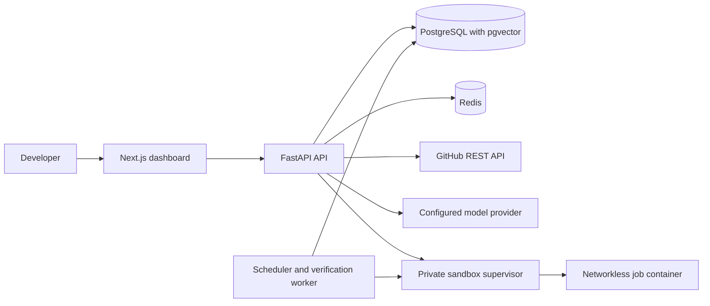

# Solvyn

<div align="center">

<h2>Your self-hosted AI engineering team</h2>

<p>Connect a GitHub project, assign engineering work to a configured teammate, and review the workspace changes and verification results before opening a draft pull request.</p>

<p>
  <a href="#features">Features</a> |
  <a href="#architecture">Architecture</a> |
  <a href="#quick-start">Quick Start</a> |
  <a href="./API.md">API</a> |
  <a href="#documentation">Docs</a>
</p>

[](https://github.com/mahirmlk/Solvyn/actions/workflows/ci-cd.yml)


</div>

Solvyn gives engineering teams a self-hosted place to configure AI teammates, connect GitHub projects, assign scoped work, and review task history. GitHub-seeded task workspaces use selected repository files pinned to a commit; other workspaces can start from supplied UTF-8 files. Teammate tools follow project permissions, and verification runs use fixed command profiles in an isolated container. An owner or admin can inspect a task diff and request a draft pull request. A person decides whether to merge it; production deployment follows a separate operator-controlled workflow.

> Solvyn is under active development. The repository, task, workspace, approval, and delivery components are present. The full product workflow and production deployment still need release validation. See the [shipment readiness assessment](./docs/SHIPMENT_READINESS.md).

## Features

### Repository context and task assignment

Connect public GitHub repositories or private repositories authorized through an encrypted organization integration. Solvyn inspects bounded repository trees and manifests, then lets an authorized user seed a task workspace with selected files at one pinned commit. Tasks keep their dependencies, handoffs, status, and activity in PostgreSQL.

Repository inspection extracts static direct dependency names from supported manifests at the root and one directory below. Discovery is bounded and deterministic; it does not resolve versions, scan for vulnerabilities, or report available updates.

### Permission-scoped teammate work

Teammates receive file tools according to the grants on their task. Those tools can list, read, search, write, or delete workspace files. The runtime records tool activity without copying file contents into the audit record.

### Verification and delivery

Teammates can request fixed test, build, lint, type-check, or security profiles. An owner or admin approves verification before the networkless, resource-limited container runs it. Solvyn saves bounded output and the workspace digest with each result. An owner or admin can inspect the diff and create a draft pull request from the pinned source revision.

### Persistent teammate conversations

Users can save and resume teammate conversations scoped to an assigned project. Recent messages are bounded before they are passed as context; direct conversations do not grant workspace tools.

### Operations and hosting

Task history includes approvals, verification attempts, delivery records, and recorded usage. Configured GitHub events and recurring maintenance checks appear for human review. Use the development Compose stack locally or follow the production Compose guide. The Kubernetes workflow needs operator configuration; it has not been validated in a controlled deployment.

## Architecture



The API stores durable task and approval state in PostgreSQL. Redis supports messaging and coordination. In the production Compose setup, only the trusted sandbox supervisor receives Docker Engine access; job containers do not receive host credentials or network access.

## Quick Start

### Requirements

- Python 3.12 or newer
- Node.js 20 or newer
- Docker Engine with Docker Compose v2
- An LLM provider key for model-backed tasks

PostgreSQL with pgvector and Redis run in the development Compose stack.

### 1. Clone and install

```bash
git clone https://github.com/mahirmlk/Solvyn.git
cd Solvyn
python -m pip install -e ".[dev]"
cd frontend
npm ci
cd ..
```

On Windows PowerShell, activate a virtual environment with `.venv\Scripts\Activate.ps1` if you created one. On macOS or Linux, use `source .venv/bin/activate`.

### 2. Configure the environment

Copy `.env.example` to `.env`. Set unique local values for `POSTGRES_PASSWORD`, `JWT_SECRET`, and `API_KEY_SECRET`, and add a key for the LLM provider you use. Solvyn supports OpenRouter, Groq, and DeepSeek provider configuration. Keep `.env` out of source control.

Public registration is disabled by default. For a local-only setup, set `ALLOW_PUBLIC_REGISTRATION=true`. For a networked deployment, keep it disabled and use the one-time bootstrap flow described in `.env.example` and [DEPLOYMENT.md](./DEPLOYMENT.md).

### 3. Start the database and Redis

```bash
docker compose up -d db redis
alembic upgrade head
```

### 4. Start the API and dashboard

In one terminal, from the repository root:

```bash
uvicorn solvyn.main:app --reload --host 0.0.0.0 --port 8000
```

In another terminal:

```bash
cd frontend
npm run dev
```

Open [http://localhost:3000](http://localhost:3000). The API reference is at [http://localhost:8000/docs](http://localhost:8000/docs). The frontend uses `http://localhost:8000/api/v1` by default; set `SOLVYN_API_URL` on the frontend server to change it.

### CLI

Install the Python package, then run `solvyn --help`. The CLI includes status and provider checks, agent and workflow listings, task runs, workflow pipelines, and observability commands.

## How a task workspace works

1. An organization owner or admin connects a repository to a project.
2. An authorized user assigns work to a teammate with explicit permissions.
3. An authorized user creates a workspace from selected repository files or supplied UTF-8 files. Repository files are read at one pinned commit.
4. The teammate uses only the file tools allowed by its grants. Teammate verification requests use fixed profiles and require owner or admin approval.
5. An owner or admin inspects the diff and digest, then can create a draft pull request on GitHub.

Solvyn treats repository content as untrusted input. The organization GitHub token is encrypted at rest and used by the API to access linked repositories; it is not sent to the model or sandbox. Tenant-owned records use PostgreSQL row-level security.

## Current limits

- Repository workspaces contain selected files; the current task flow does not create a full clone or Git worktree.
- Teammates cannot run arbitrary shell commands or install project dependencies. Verification uses fixed profiles in a networkless sandbox.
- Before a task workspace exists, repository search matches file paths. Content search is available inside an assigned workspace.
- Delivery opens a draft pull request. A person reviews and merges it.
- Dependency review schedules currently create reminders; Solvyn does not bundle a dependency vulnerability scanner.
- The combined conversation-to-task-to-verified-delivery workflow, controlled staging deployment, and deployment-specific restore drill remain unverified. See [shipment readiness](./docs/SHIPMENT_READINESS.md) for the current release assessment.

## Development and checks

Start PostgreSQL and Redis as shown above, then run:

```bash
make lint
make typecheck
make test
```

The test suite includes PostgreSQL-backed integration coverage. CI also builds the API and frontend images and runs dependency vulnerability checks. Sandbox container integration tests require a running Linux Docker Engine and are opt-in; see [the sandbox runtime guide](./docs/SANDBOX_RUNTIME.md).

## Documentation

| Guide | What it covers |
|---|---|
| [Architecture](./ARCHITECTURE.md) | Services, data flow, and design decisions |
| [API reference](./API.md) | Routes, authentication, schemas, and errors |
| [Deployment](./DEPLOYMENT.md) | Local setup, self-hosted Compose, Kubernetes workflow, backup, and recovery |
| [Security](./SECURITY.md) | Authentication, tenant isolation, integrations, and execution boundaries |
| [Repository intelligence](./docs/REPOSITORY_INTELLIGENCE.md) | GitHub connection, repository inspection, and access limits |
| [Sandbox runtime](./docs/SANDBOX_RUNTIME.md) | Workspace tools, verification profiles, and container isolation |
| [Shipment readiness](./docs/SHIPMENT_READINESS.md) | Implemented scope and release blockers |
| [Contributing](./CONTRIBUTING.md) | Development setup and contribution workflow |

## License

This repository does not currently include a `LICENSE` file, so no license is declared here.
