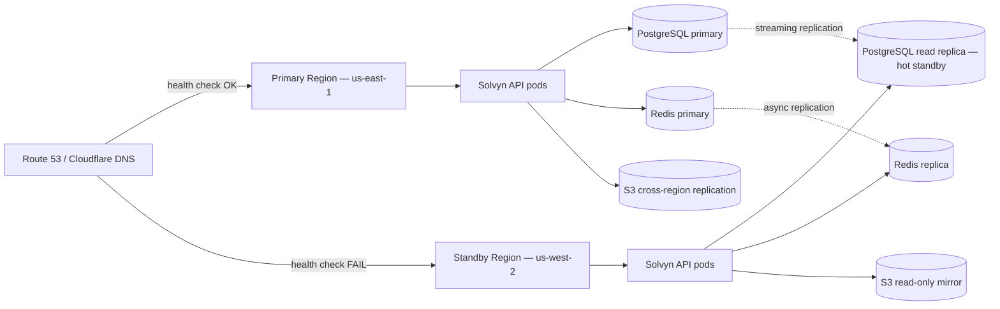

# Solvyn — Multi-Region Failover Plan

> **Audience:** SRE, Platform Engineering, and on-call operators.
> **Goal:** Define how Solvyn stays available when an entire region goes
> dark, and what to do when it does.

Solvyn is a multi-tenant, stateful control plane (PostgreSQL, Redis,
pgvector embeddings) running in Kubernetes. This document describes the
target architecture for surviving a regional outage, the data-replication
topology that supports it, and the operational runbook for executing and
validating a failover.

---

## 1. Architecture Decision: Active-Passive vs. Active-Active

| | Active-Passive (recommended for v1) | Active-Active |
|---|---|---|
| **Latency** | Best in the home region, ~50 ms added elsewhere | Equal everywhere |
| **Cost** | 1× idle standby region | 2×+ write capacity |
| **Failure domain** | Whole region | Per-region |
| **Write conflicts** | None (single primary) | Must be resolved (CRDT, last-write-wins, or per-tenant pinning) |
| **Operational complexity** | Low | High |

**Decision: ship active-passive first.** Solvyn's tenants are global
software teams, not latency-sensitive consumers; an extra 50 ms to a
chat endpoint is acceptable, but lost sessions or out-of-order audit
events are not. Active-active is on the roadmap once the v1 multi-region
foundation is proven.



---

## 2. Database Replication (PostgreSQL + pgvector)

### 2.1 Topology

* **Primary** in the home region handles all writes.
* **Hot-standby replica** in the standby region, promoted during failover.
* **Read replicas** (1–3 per region) absorb dashboard, audit log, and
  analytics queries so the primary is free for transactional traffic.

### 2.2 Streaming replication

```ini
# postgresql.conf (primary)
wal_level = replica
max_wal_senders = 10
wal_keep_size = '2GB'
synchronous_commit = on
synchronous_standby_names = 'standby-1,standby-2'
```

```ini
# postgresql.conf (standby)
hot_standby = on
primary_slot_name = 'standby_slot'
```

Promote a standby when the primary is unreachable:

```bash
pg_ctl promote -D /var/lib/postgresql/data
```

### 2.3 pgvector considerations

The `pgvector` extension is stateless at the catalog level; vectors and
HNSW/IVFFlat indexes replicate through the standard WAL stream, so no
extra plumbing is required. One caveat: large HNSW indexes slow down
replication; size them so a full rebuild fits in the WAL keep window.

### 2.4 RPO / RTO for the database

| Metric | Target | Notes |
| --- | --- | --- |
| **RPO** | ≤ 5 s | Achievable with synchronous_commit=on and a healthy replica |
| **RTO** | ≤ 10 min | Includes detection, promotion, and app cutover |

---

## 3. Redis High Availability

Solvyn uses Redis for:

* the **message bus** (pub/sub between agents),
* the **rate limiter** (sliding-window counters),
* short-lived **LLM response caches**.

Loss of any of these is recoverable without data loss — the message bus
is best-effort, the rate limiter falls back to in-memory, the cache
rebuilds naturally — so we can use a simpler topology than the database.

### 3.1 Redis Sentinel (recommended for v1)

* 1 primary + 2 replicas per region.
* 3 Sentinel nodes (odd number, distributed across AZs).
* Promotion is automatic; clients re-resolve via Sentinel.

```yaml
# values.yaml (Bitnami Redis chart)
sentinel:
  enabled: true
  quorum: 2
redis:
  master:
    persistenceEnabled: true
  replica:
    persistenceEnabled: true
    replicaCount: 2
```

### 3.2 Redis Cluster (v2)

Cluster is only needed when the working set exceeds a single node's RAM
or when you need to spread writes geographically. It adds sharding and
client complexity that v1 doesn't need.

### 3.3 RPO / RTO for Redis

| Metric | Target | Notes |
| --- | --- | --- |
| **RPO** | 0–1 s | Async replication; some loss acceptable |
| **RTO** | ≤ 30 s | Sentinel auto-promotion |

---

## 4. DNS-Based Failover

Use a managed DNS provider with health-checked records:

* **AWS Route 53** — health-check on `https://api.solvyn.example.com/health`
  from multiple global probe points.
* **Cloudflare Load Balancer** — equivalent, with the bonus of anycast IPs
  and integrated DDoS protection.

```hcl
# Terraform (Route 53)
resource "aws_route53_health_check" "solvyn_primary" {
  fqdn              = "api.us-east-1.solvyn.example.com"
  port               = 443
  type               = "HTTPS"
  resource_path      = "/api/v1/health"
  failure_threshold  = 3
  request_interval   = 10
}

resource "aws_route53_record" "solvyn_active" {
  zone_id = aws_route53_zone.solvyn.zone_id
  name    = "api.solvyn.example.com"
  type    = "A"
  alias {
    name                   = aws_lb.primary.dns_name
    zone_id                = aws_lb.primary.zone_id
    evaluate_target_health = true
  }
  failover_routing_policy {
    type = "PRIMARY"
  }
  set_identifier = "primary"
}
```

**TTL guidance:** keep the DNS TTL at 60 s for the apex record; longer
TTLs make failover feel slow, shorter TTLs hammer resolvers.

---

## 5. Kubernetes Multi-Cluster Considerations

Solvyn runs on Kubernetes. For multi-region we use **active-passive
clusters** rather than a single stretched cluster — etcd latency across
regions kills quorum health, and cross-region pod-to-pod traffic is
prohibitively expensive.

### 5.1 Cluster topology

* `solvyn-prod-use1` (primary, `us-east-1`)
* `solvyn-prod-usw2` (standby, `us-west-2`)

Each cluster is independent: its own control plane, its own node pools,
its own ingress controller.

### 5.2 GitOps

Both clusters reconcile from the same Argo CD / Flux source tree, so a
config change in the home region is mirrored to the standby automatically.
Region-specific overrides (DB endpoints, Redis sentinels, ingress hosts)
live in a per-cluster values file.

### 5.3 Pod readiness

The Solvyn API exposes `/api/v1/health/deep` for the Kubernetes
`readinessProbe`. Pods that lose their database or Redis connection are
marked **NotReady** and pulled from the Service's endpoint set; if the
whole cluster loses its database, all pods go NotReady, the AWS load
balancer's target group health check fails, Route 53 fails over, and
traffic shifts to the standby region.

### 5.4 Stateful workloads

* `StatefulSet` for Redis (per-AZ affinity, persistent volumes).
* External managed **RDS** (or Cloud SQL) for PostgreSQL so that the
  standby cluster doesn't need to re-init a fresh database after
  failover.
* Object storage (S3 / GCS) cross-region replication for audit log
  exports and conversation backups.

---

## 6. RPO / RTO Targets

| Component | RPO (data loss) | RTO (downtime) | Notes |
| --- | --- | --- | --- |
| **PostgreSQL** | ≤ 5 s | ≤ 10 min | Synchronous replication + warm standby |
| **Redis** | ≤ 1 s | ≤ 30 s | Sentinel auto-promotion |
| **Object storage (S3)** | 0 (last 15 min) | ≤ 5 min | Cross-region replication |
| **API pods (stateless)** | N/A | ≤ 60 s | New pods schedule in standby region |
| **Prometheus metrics** | ≤ 5 min | ≤ 10 min | Remote-write to central Thanos |
| **Audit log** | 0 | ≤ 5 min | Append-only stream mirrored cross-region |

These targets are reviewed quarterly. If a single component is the long
pole (e.g. PostgreSQL promotion at 10 min), we either accept the gap or
fund a project to close it (e.g. PgBouncer + hot replica pre-warmed).

---

## 7. Cross-Region Disaster Recovery Steps

### 7.1 Detection

The on-call is paged when:

1. Route 53 health check fails for **> 2 minutes** in the home region, **OR**
2. The deep health check returns `degraded` for **> 3 minutes**, **OR**
3. Prometheus alerts fire on the standby region's synthetic canary
   failing from the home region (the canary is the "is the other side up
   from my perspective" check).

### 7.2 Declaration

1. Page the **Incident Commander** (IC).
2. Open an incident channel: `#inc-YYYY-MM-DD-region-failover`.
3. Start the timeline document in Notion / Confluence.
4. The IC declares a disaster at the first all-hands; the **DR lead**
   begins the runbook below.

### 7.3 Failover (the runbook)

The runbook is **automated** via the `solvyn-cli dr` command (see §8) and
**manual** in the case automation is broken — both paths are validated
quarterly.

**Automated path:**

```bash
solvyn-cli dr failover \
  --from us-east-1 \
  --to   us-west-2 \
  --reason "INC-1234 — primary region unreachable" \
  --confirm
```

**Manual path:**

1. **Promote the PostgreSQL standby.**
   ```bash
   aws rds promote-read-replica \
     --db-instance-identifier solvyn-usw2-standby \
     --region us-west-2
   ```
2. **Reconfigure Redis Sentinel** so the application clients in
   `us-west-2` now point at the new primary sentinel set.
3. **Scale the standby cluster.**
   ```bash
   kubectl --context solvyn-prod-usw2 scale deploy solvyn-api --replicas=12
   ```
4. **Flip the DNS.** Route 53 will switch on its own once the standby
   health check passes, or you can lower the TTL and update the record
   manually.
5. **Smoke-test.** Run `solvyn-cli dr verify` (see §8).
6. **Declare success** in the incident channel and schedule the
   post-incident review.

### 7.4 Failback

Failback is **deliberately manual** to avoid flapping. Once the home
region is healthy for 24 h:

1. Drain traffic from the standby (set standby read-only).
2. Promote the home region's database back to primary.
3. Replay the WAL gap with `pg_basebackup` if needed.
4. Flip DNS back.
5. Open a PR for the post-mortem.

---

## 8. Operator Runbook

The `solvyn-cli dr` command surfaces the runbook as a series of
sub-commands. It is intentionally **destructive without `--confirm`** —
it should be run from a bastion that has audit logging enabled.

| Command | Purpose |
| --- | --- |
| `solvyn-cli dr status` | Show current region topology and replication lag |
| `solvyn-cli dr failover --from X --to Y` | Execute a region failover |
| `solvyn-cli dr failback` | Return traffic to the home region |
| `solvyn-cli dr verify` | Run smoke tests against the active region |
| `solvyn-cli dr promote-db --region X` | Manually promote the DB replica in region X |
| `solvyn-cli dr rotate-secrets` | Re-issue API keys after a region boundary crossing |

### 8.1 `solvyn-cli dr status`

```text
$ solvyn-cli dr status
Region         Role        DB lag    Redis role     Health
us-east-1      PRIMARY     n/a       master         ok
us-west-2      STANDBY     3.2 s     replica        ok
```

### 8.2 `solvyn-cli dr verify`

Runs the following checks against the active region and exits non-zero on
any failure:

* `GET /api/v1/health/deep` → 200
* `GET /api/v1/sessions/` with a valid API key → 200
* `POST /api/v1/workflows/{feature}/run` with a smoke-test spec → 200
* `GET /api/v1/observability/metrics` → 200
* Postgres replication lag < 5 s
* Redis sentinel quorum intact

### 8.3 Quarterly DR drill

1. Pick a non-peak window.
2. Notify the on-call rotation and the product team.
3. Run `solvyn-cli dr failover --from us-east-1 --to us-west-2`.
4. Validate the smoke tests.
5. Run `solvyn-cli dr failback`.
6. Write a one-page retro of what worked and what didn't.

---

## 9. Open Questions / Future Work

* **Active-active** for hot tenants that want regional write locality.
* **Multi-region write quorum** for the audit log so an outage can't lose
  audit events.
* **Cross-region read-only mode** so a degraded region can still serve
  dashboards and historical reports while the home region recovers.
* **Chaos engineering** with LitmusChaos to validate the runbook in
  staging before every quarterly drill.
